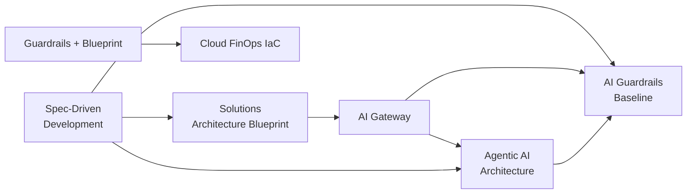

# Hola, soy Javier Esteban 👋

**Solutions Architect** · .NET & Azure · Multi-Cloud · AI & Agentic Systems

Diseño arquitecturas **enterprise** que combinan la madurez de plataformas
microsoft/.NET con el presente de la **IA**: de la capa de contratos (Spec-Driven
Development) a la operación de costos (FinOps → IaC).

## 🛒 Lo que estoy construyendo

| Repo | Área | Idea |
|------|------|------|
| [`solutions-architecture-blueprint`](https://github.com/jaesmon/solutions-architecture-blueprint) | .NET · DDD · CQRS+ES · Hexagonal | Blueprint de servicios enterprise listo para escalar (eventos + outbox) |
| [`agentic-ai-architecture`](https://github.com/jaesmon/agentic-ai-architecture) | Agentic AI · MCP · A2A | Arquitectura de agentes en producción: orchestrators, memoria, lazos controlados |
| [`ai-gateway`](https://github.com/jaesmon/ai-gateway) | IA · Gateway · Multi-provider | Un solo contrato LLM (OpenAI, Anthropic, Azure, Bedrock) con ruteo, cache y costos |
| [`ai-guardrails-baseline`](https://github.com/jaesmon/ai-guardrails-baseline) | Seguridad IA · Gobernanza | Lineamientos y políticas (OPA, OWASP LLM Top 10) + evals con gate de release |
| [`spec-driven-development`](https://github.com/jaesmon/spec-driven-development) | Contratos · OpenAPI · AsyncAPI | Contratos como fuente de verdad: codegen, stub-first y contract testing |
| [`cloud-finops-iac`](https://github.com/jaesmon/cloud-finops-iac) | Multi-Cloud · Terraform · FinOps | IaC que nace con presupuestos, tagging y dashboards de costo |

## 🏗️ El hilo que une todo

Contratos → Despliegue seguro → IA bajo gobierno → Costo bajo control:

## 💼 Experiencia

- **Arquitectura enterprise** en .NET/Node/SQL Server y Azure (migración on-prem → cloud).
- **Adopción de IA** responsable: baseline de lineamientos, gateways LLM y agentes MCP/A2A.
- **FinOps**: de la infraestructura on-premise al costo por célula y la optimización de IA.

## 📬 Conectemos

- LinkedIn: [javier-esteban](https://www.linkedin.com/in/javier-esteban-18587a101)
- Email: _a tu inbox_ 🙃